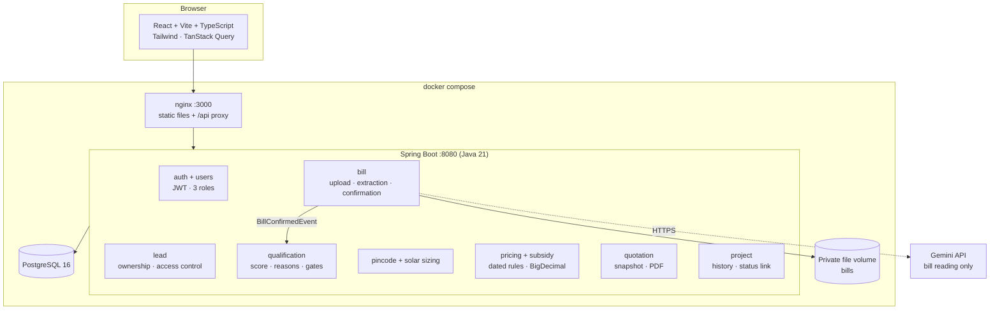

#  SolarFlow

Rooftop-solar lead qualification, quotation and project tracking for **Company A, Nagpur** — an internship assignment.

A homeowner submits a short enquiry and an electricity bill. AI reads the bill, the homeowner confirms the values, and the system scores the lead and recommends a system size. Sales issue a quotation with subsidy and payback worked out from dated rule tables, the homeowner accepts it, and the project is tracked from advance payment to subsidy credit through a private customer status link.

> All prices, tariffs and subsidy values in the seed data are **hypothetical placeholders**. The subsidy rule (₹30,000/kW for the first 2 kW + ₹18,000 for the third, capped at ₹78,000) is the client's figure, stored as **unverified** and labelled as an estimate on every quotation.

---

## Contents

1. [Quick start](#quick-start)
2. [Demo accounts](#demo-accounts)
3. [The workflow](#the-workflow)
4. [Architecture](#architecture)
5. [Business rules and decisions](#business-rules-and-decisions)
6. [Screens](#screens)
7. [API overview](#api-overview)
8. [Security and personal data](#security-and-personal-data)
9. [Running without Docker](#running-without-docker)
10. [Tests](#tests)
11. [Scope: done, deferred and out of scope](#scope-done-deferred-and-out-of-scope)

---

## Quick start

Requirements: **Docker Desktop**. Nothing else.

```bash
# 1. Create the env file and fill it in (see table below)
cp .env.example .env

# 2. Build and start database, backend and frontend
docker compose up -d --build

# 3. Open the app
#    http://localhost:3000
```

On first start the backend creates the tables, then seeds: 10 Nagpur pincodes, one pricing rule, one subsidy rule, the admin and sales accounts, and the three client sample leads. A fresh database is demo-ready.

| Service | URL | Notes |
|---|---|---|
| Frontend (nginx) | http://localhost:3000 | Also proxies `/api` to the backend, so the browser never makes cross-origin calls |
| Backend (Spring Boot) | http://localhost:8081/api/v1 | Health: `/actuator/health` |
| PostgreSQL | localhost:5432 | Data in the `solarflow_pgdata` volume |

### Environment variables (`.env`)

| Variable | Required | Example | Purpose |
|---|---|---|---|
| `DB_NAME`, `DB_USER`, `DB_PASSWORD` | Yes | `solarflow` / `solarflow` / `pass` | PostgreSQL |
| `DB_HOST`, `DB_PORT` | No | `localhost`, `5432` | Overridden to `db:5432` inside Docker |
| `JWT_KEY` | Yes | output of `openssl rand -base64 48` | Signs login tokens |
| `JWT_EXPIRY_MINUTES` | No | `240` | Session length (default 15) |
| `SEED_PASSWORD` | For demo | `Sales@12345` | Password for every seeded account. No spaces around `=` |
| `SEED_DEMO_LEADS` | No | `true` | Set `false` to skip the three sample leads |
| `GEMINI_API_KEY` | No | — | Bill reading. If empty, extraction fails safely and the customer enters values manually |
| `GEMINI_MODEL` | No | `gemini-3.6-flash` | |
| `APP_CORS_ALLOWED_ORIGINS` | No | `http://localhost:5173,http://localhost:3000` | Only needed for `npm run dev` |
| `STORAGE_DIR` | No | `./storage` | Bill files when running without Docker |

To start again from an empty database: `docker compose down -v && docker compose up -d --build`.

---

## Demo accounts

All accounts use the `SEED_PASSWORD` value.

| Role | Email | What to show |
|---|---|---|
| Admin | `admin@solarflow.local` | Pincodes, pricing and subsidy rules (plus everything sales can do) |
| Sales | `sales@solarflow.local` | Lead list, qualification, sizing, quotation, projects |
| Homeowner | `prashant@solarflow.local` | **LD-30881** — owner, ₹3,200 bill, 340 units → score 100, survey recommended, 2.5 kW |
| Homeowner | `rohit@solarflow.local` | **LD-30902** — tenant, ₹1,900, 210 units → score 50, sales call (not owner + low usage) |
| Homeowner | `ayesha@solarflow.local` | **LD-30915** — owner, ₹650, 85 units → score 75 but sales call (low usage); 0.5 kW, not viable |

Roof type and area (RCC flat, 400 / 400 / 300 sq ft) and sanctioned load (5 / 3 / 2 kW) are not in the client sheet; they are assumptions.

### Five-minute demo script

1. **Sales** → open Prashant → score 100 with six reasons → options 1.5 / 2.5 / 4.0 kW, limited by usage.
2. Pick **2.5 kW** → *Issue quotation* → ₹1,50,000 − ₹69,000 subsidy = **₹81,000**, payback **2.89 years** → download the PDF.
3. **Prashant** → *Quotation ready* → *Accept quotation*.
4. **Sales** → enter advance ₹20,000 → *Create project* → copy the status link.
5. Open the link in a private window (no login, no personal data) → move the project to *Installation scheduled* → refresh the link.
6. **Sales** → open Rohit and Ayesha → both routed to a call, neither rejected.
7. **Admin** → add a new pricing rule → reopen Prashant's quote → unchanged.

---

## The workflow

```mermaid
flowchart LR
    A[Homeowner<br/>enquiry form] --> B[Upload bill<br/>JPG / PNG / PDF ≤ 8 MB]
    B --> C[AI reads bill<br/>Gemini, async]
    C --> D{Homeowner confirms<br/>or corrects values}
    D -->|poor photo| B
    D --> E[Qualification<br/>score + reasons + gates]
    E -->|score ≥ 70, no gate| F[Survey recommended]
    E -->|otherwise| G[Short sales call]
    F --> H[Sizing<br/>Economy / Recommended / Maximum]
    G --> H
    H --> I[Sales issues quotation<br/>price + subsidy + payback<br/>rules frozen in snapshot]
    I --> J[PDF]
    I --> K[Homeowner accepts]
    K --> L[Project<br/>advance recorded]
    L --> M[Advance paid → Installation scheduled<br/>→ Installed → Subsidy credited]
    M --> N[Public status link<br/>stage + dates only]
```



| Step | Who | Lead status after |
|---|---|---|
| Create enquiry | Homeowner | `NEW` |
| Upload bill | Homeowner | `BILL_UPLOADED` |
| Confirm bill values | Homeowner | `BILL_CONFIRMED` → qualification runs automatically |
| Qualification | System (sales can re-run) | `SURVEY_RECOMMENDED` or `SALES_CALL_PENDING` |
| Issue quotation | Sales / Admin | `QUOTED` |
| Accept quotation | Homeowner only | `ACCEPTED` |
| Mark lost / reopen | Sales / Admin | `LOST` / `SALES_CALL_PENDING` |

---

## Architecture

A **modular monolith**: one Spring Boot service with a package per business module, one PostgreSQL database and a thin React frontend. Modules talk through in-process calls and Spring application events; there is no message broker.



| Package | Responsibility |
|---|---|
| `auth`, `user` | Register, login, JWT filter, role checks, staff seeding |
| `lead` | Enquiry CRUD, homeowner ownership checks, staff list / filters / stats, demo lead seeding |
| `bill` | File validation (magic bytes, 8 MB), private storage, SHA-256, async Gemini extraction, confidence handling, human confirmation |
| `qualification` | Deterministic score with reasons and gates, persisted with the rule-set version, triggered by `BillConfirmedEvent` |
| `pincode` | Serviceable pincodes (admin managed) |
| `solar` | Capacity options from confirmed units, roof area and sanctioned load |
| `pricing` | Effective-dated pricing and subsidy rules, overlap checks, BigDecimal calculation |
| `quotation` | Quote creation with a JSON snapshot of every input and output, PDF, accept |
| `project` | Project from an accepted quote, forward-only stages, history, revocable status link |

Frontend layout: `src/api` (one file per backend area), `src/features` (feature components), `src/pages` (one per route), `src/components` (shared UI). No business calculation happens in the browser; every figure comes from the API.

---

## Business rules and decisions

**AI is used only to read the bill.** Scoring, sizing, pricing and subsidy are deterministic code. When the AI is wrong or unavailable, the extracted values sit beside the bill for the homeowner to correct, a poor photo asks for a re-upload, and a failed extraction falls back to manual entry. Only human-confirmed values are used downstream.

### Qualification (0–100, configurable in `application.yaml`)

| Rule | Points |
|---|---|
| Applicant owns the property | 25 |
| Roof type suitable (RCC flat, tin sheet, tiled) | 15 |
| Roof area ≥ 300 sq ft (enough for 3 kW) | 15 |
| Monthly units ≥ 250 | 25 |
| Pincode serviceable | 10 |
| Bill read with AI confidence ≥ 0.80 | 10 |

- **Score ≥ 70 and no gate → survey recommended. Otherwise → short sales call.**
- **Gates** force a call regardless of score: *not the property owner*, and *below the minimum usage*. They are needed because the raw weights let a small-bill owner reach 75 (Ayesha) and would let a tenant score highly.
- **A low score never rejects a lead.** Sales can always proceed.
- Every result stores the score, one reason per rule, the gates and the rule-set version. Re-running appends a new result.

### Sizing

```
capacity = min( monthly units × 12 ÷ 1,400 ,  roof area ÷ 100 ,  sanctioned load )
           rounded DOWN to the nearest 0.5 kW
```

- 1,400 units/kW/year and 100 sq ft/kW are configurable and copied into every quotation snapshot.
- Options: **Recommended** (the result), **Economy** (70 % of recommended, rounded down), **Maximum** (roof / load limit). Duplicates and 0 kW options are dropped.
- The limiting factor (usage, roof or load) is shown.
- Below 1 kW the lead is marked **not viable** and cannot be quoted; it goes to a sales call.

**Known difference from the client sheet:** rounding down gives Prashant **2.5 kW** (340 × 12 ÷ 1,400 = 2.91) where the sheet says 3 kW, and Ayesha **0.5 kW** where the sheet says 1 kW. We kept round-down so a system is never sized above the customer's usage; this needs client confirmation.

### Pricing, subsidy and payback

| Item | Rule |
|---|---|
| Price | `capacity × price per kW` from the pricing rule effective on the quotation date |
| Subsidy | `min(capacity, 2) × first-2-kW rate + min(max(capacity − 2, 0), 1) × third-kW rate`, capped at the maximum. Fractional kW above 2 is **prorated** (2.5 kW → ₹69,000) |
| Net payable | gross − subsidy, never below zero |
| Annual savings | capacity × 1,400 × tariff per unit |
| Payback | net payable ÷ annual savings (2 decimals); "not available" when savings ≤ 0 |

- All money uses `BigDecimal` (scale 2, HALF_UP) and `NUMERIC` columns.
- Rules have `effective_from` / `effective_to` (open-ended allowed). Active rules may not overlap; no rule in force → a clear error, never a guess. Rules are deactivated, never deleted.
- **Immutability:** a quotation stores a JSON snapshot of every input and output, including the pricing-rule and subsidy-rule ids. Changing rules later never changes an issued quotation, and its PDF is regenerated from the snapshot.
- Only one quotation per lead can be accepted; after that no new quotations can be issued.

### Projects

- Created by sales from an **accepted** quotation, with an advance (> 0 and ≤ net cost).
- Stages move **forward only, one at a time**: Advance paid → Installation scheduled → Installed → Subsidy credited. Every change is stored in a history table with an optional internal note.
- The customer status link uses a random 256-bit token, can be revoked and re-enabled by staff, and shows only the stage, capacity and dates.

---

## Screens

| Area | Screen | Route |
|---|---|---|
| Public | Login, register | `/login`, `/register` |
| Public | Customer status page (no login) | `/status/:token` |
| Homeowner | My applications | `/app` |
| Homeowner | New enquiry (with live pincode check) | `/app/new` |
| Homeowner | Bill upload, AI result beside the bill, confirm / correct | `/app/:leadId/bill` |
| Homeowner | Application: status, quotation story (size → cost after subsidy → payback), accept, installation progress | `/app/:leadId` |
| Sales | Leads: counts per status, search, filters | `/staff` |
| Sales | Lead: qualification, sizing, quotation builder, issued quotes, create project, survey corrections | `/staff/leads/:leadId` |
| Sales | Projects (with idle-days badge) and project detail | `/staff/projects`, `/staff/projects/:id` |
| Admin | Serviceable pincodes | `/admin/pincodes` |
| Admin | Pricing & subsidy rules (with live subsidy preview) | `/admin/rules` |

Homeowners never see the score or internal stage names; statuses are shown in plain language.

---

## API overview

Base path `/api/v1`. All endpoints need `Authorization: Bearer <token>` except login, register and `GET /status/{token}`. Errors return `{ status, code, message, fieldErrors }`.

| Method | Path | Roles |
|---|---|---|
| POST | `/auth/register`, `/auth/login` | Public |
| GET | `/users/me` · `/users/staff` | Any · Sales, Admin |
| POST / GET | `/leads` | Homeowner, Sales create · all list (homeowners see their own) |
| GET / PATCH | `/leads/{id}` | Owner, Sales, Admin · Sales, Admin |
| GET | `/leads/stats` | Sales, Admin |
| POST / GET | `/leads/{id}/documents` | Owner, Sales, Admin |
| GET | `/documents/{id}/extraction` · `/documents/{id}/file` | Owner, Sales, Admin |
| POST | `/documents/{id}/extraction/confirm` | Owner, Sales, Admin |
| GET / POST | `/leads/{id}/qualification` | View: owner, staff · Run: Sales, Admin |
| GET | `/leads/{id}/recommendations` | Owner, Sales, Admin |
| GET | `/pincodes/{pincode}/serviceable` | Any signed-in user |
| POST / GET | `/leads/{id}/quotations` | Create: Sales, Admin · List: owner, staff |
| GET | `/quotations/{id}` · `/quotations/{id}/pdf` | Owner, Sales, Admin |
| POST | `/quotations/{id}/accept` | Homeowner (owner) only |
| POST / GET | `/projects` | Create: Sales, Admin · List: staff all, homeowner own |
| GET | `/projects/{id}` | Owner, Sales, Admin |
| POST | `/projects/{id}/status` | Sales, Admin |
| PATCH | `/projects/{id}/status-link` | Sales, Admin |
| GET | `/status/{token}` | Public |
| GET / POST / PATCH | `/admin/pincodes`, `/admin/pricing-rules`, `/admin/subsidy-rules` | Admin |

---

## Security and personal data

Consumer numbers, addresses and bills are personal data under the DPDP Act 2023. This prototype applies basic protection; it does **not** claim DPDP compliance.

- Bills are stored outside the web root under random keys; storage paths never appear in any response.
- A homeowner can only read their own leads, bills, quotations, projects and PDFs. Other ids return **404** (not 403), so ids are not revealed.
- The public status link shows only stage, capacity and dates — no name, address, phone, consumer number, bill, price or staff notes.
- Staff notes on project stages are never returned to homeowners.
- Passwords are BCrypt-hashed (strength 12); sessions are stateless JWTs.
- Consent is recorded at registration.

---

## Running without Docker

```bash
# Database only
docker compose up -d db

# Backend (port 8080)
cd backend/solarFlow
./gradlew bootRun           # reads env vars; set DB_*, JWT_KEY, SEED_PASSWORD

# Frontend (port 5173)
cd frontend
npm install
# frontend/.env.development: VITE_API_BASE_URL=http://localhost:8080
npm run dev
```

The backend's CORS list must include `http://localhost:5173` (the default).

---

## Tests

```bash
cd backend/solarFlow
./gradlew test
```

Unit tests cover the calculation and rule logic:

| Test | Covers |
|---|---|
| `QualificationScorerTest` | Each rule, sample leads Prashant (survey) and Rohit (tenant → call), tenant / leased gate, the 250-unit boundary, unserviceable pincode, custom weights, determinism |
| `SolarSizingCalculatorTest` | Usage, roof and sanctioned-load limits, economy and maximum options, round-down to 0.5 kW, below-1-kW not viable, invalid inputs |
| `PricingCalculationServiceTest` | 2.5 kW (prorated subsidy) and 3 kW systems, subsidy cap, missing or overlapping rules, invalid values |
| `PricingRuleServiceTest`, `SubsidyRuleServiceTest` | Create, overlap rejection, end-before-start, open-ended rules |
| `QuotationServiceTest` | Snapshot at creation, option validation, non-viable lead, unserviceable pincode, homeowner-only accept, idempotent accept, one accepted quote per lead, PDF from snapshot, **homeowner cannot create quotes or read another homeowner's quotes** |
| `QuotationPdfServiceTest` | PDF is generated and readable |
| `ProjectStatusTest` | Forward-only, no skipping, no going back, final stage |
| `ExtractionValidatorTest`, `LocalDocumentStorageTest` | Bill field validation and bill-vs-units cross-check, storage round trip, path-traversal rejection |

`GeminiBillExtractorLiveTest` calls the real Gemini API and only runs when a key is configured.

The full flow (enquiry → bill → confirm → score → quote → PDF → accept → project → status link) and the access checks were tested manually through the UI.

---

## Scope: done, deferred and out of scope

**Done (core build):** lead form with bill upload · AI bill reading with confirmation and re-upload · lead score with reasons · system size options · quotation with subsidy and payback from dated rules · quote PDF · project tracker with history and customer status link · admin tables for pincodes, prices and subsidy · seed data from the client sample.

**Deferred (optional in the brief):**
- WhatsApp / SMS update on each stage change (planned as a logged mock notifier)
- Full stuck-projects dashboard (currently an idle-days badge on the project list)
- Document uploads on a project
- Marathi and Hindi interface
- Database-backed integration tests for the full happy path (the flow and access checks were verified manually; access rules are also unit-tested in `QuotationServiceTest`)

**Out of scope:** government subsidy-portal filing, DISCOM net-metering integration, inventory and purchasing, inverter monitoring, real payments and messaging, microservices or a message broker.

**Open questions for the client:** round-down vs round-to-nearest sizing; the 250-unit and score-70 thresholds; the subsidy rule and its proration above 2 kW; the real price list and tariff.
